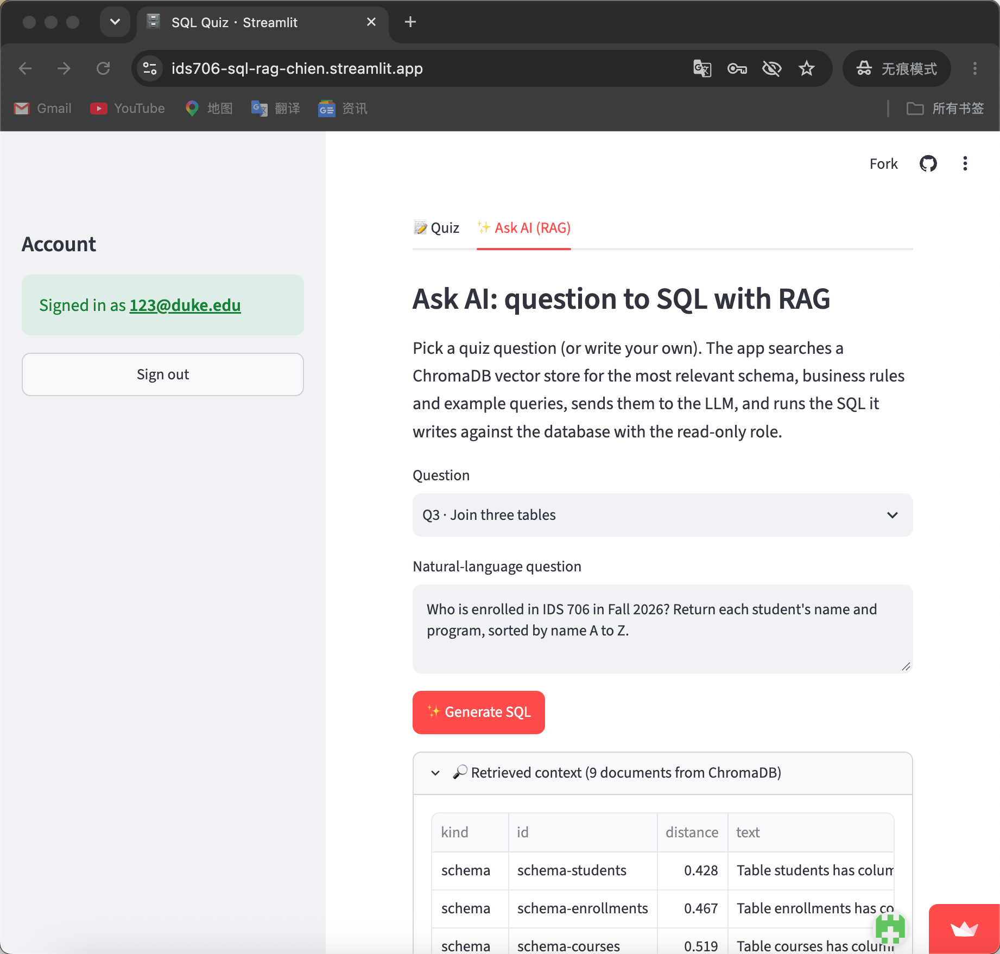
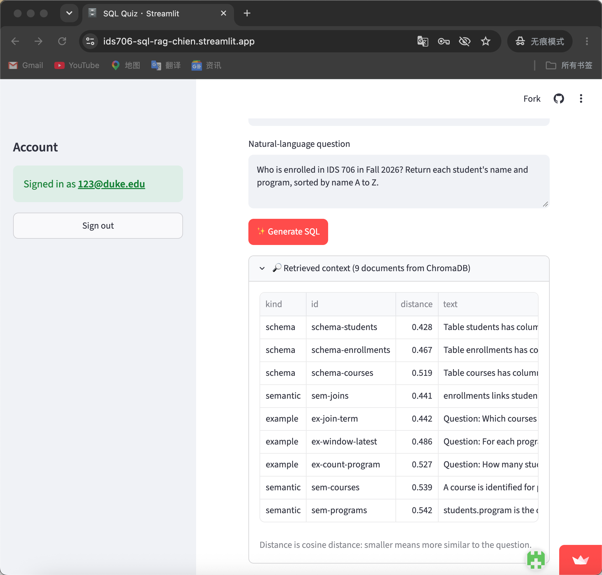
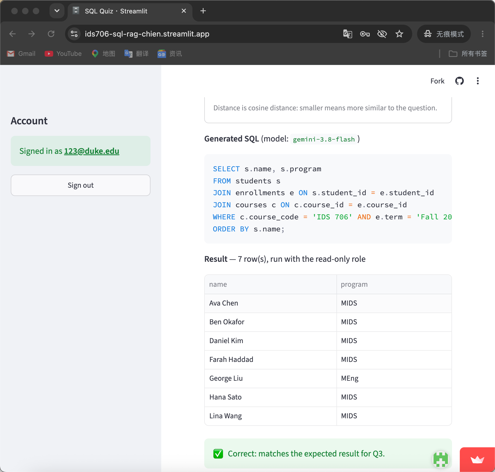

# IDS 706 SQL Quiz + RAG Text-to-SQL

[](https://github.com/Zzqc-chien/ids706-sql-rag/actions/workflows/quiz-db-check.yml)

Site: https://ids706-sql-rag-chien.streamlit.app

This builds on my Week 7 quiz ([ids706-sql-quiz](https://github.com/Zzqc-chien/ids706-sql-quiz)) and uses the same Supabase database.

(If the app is asleep, click the wake-up button and give it ~30 seconds.)

A 5-question, 20-point SQL quiz that runs against a Supabase Postgres database, plus an "Ask AI" tab that turns a question into SQL with RAG (ChromaDB + an LLM). The data is a small made-up grad school dataset: students, courses, and enrollments.

## How to take the quiz

1. Open the site and create an account in the sidebar (any email works, no confirmation needed).
2. Pick a question, write a query, and click Run. The result comes straight from the database.
3. The app tells you if your result matches the expected one. Only the rows are compared, not the SQL text.
4. Click Save to store your answer. Each question has a Hint with the expected SQL and result.

Run and Save are disabled until you sign in, and the server checks the login again before it touches the database.

| Q | Topic | Pts |
|---|---|---|
| 1 | WHERE + ORDER BY | 4 |
| 2 | GROUP BY / COUNT | 4 |
| 3 | 3-table JOIN | 4 |
| 4 | GROUP BY + HAVING | 4 |
| 5 | Window function (RANK, with ties) | 4 |

Tables: `students(student_id, name, program, start_year)`, `courses(course_id, course_code, title, department, credits)`, `enrollments(enrollment_id, student_id, course_id, term, grade_points)`. A NULL `grade_points` means the course is still in progress.

## How it works

**Database:** Supabase Postgres, connected through the Session pooler with `sslmode=require`. `sql/init.sql` creates everything.

**Auth:** Supabase Auth (email + password).

**App:** Streamlit (`app.py`). Shared logic lives in `quizlib.py`, and the questions live in `questions.json`.

**Two DB roles:**
  - `quiz_reader` runs the taker's SQL. It is read-only (SELECT on the quiz tables only), with a 5 s timeout.
  - `quiz_app` saves answers and writes the audit log. It can INSERT but cannot UPDATE or DELETE.

**RLS** is on for all tables, with policies that match the roles above.

**CI:** `.github/workflows/quiz-db-check.yml` runs on every push and twice a week. It reads the DB credentials from GitHub Secrets and runs `scripts/check_quiz.py`, which runs each hint query and compares it with the expected result. It also checks that the reader can't delete data and that the audit log can't be edited. The scheduled runs also keep the free Supabase project from pausing.

No passwords are in the repo. Locally they live in `.env` (gitignored), in CI they come from GitHub Secrets, and on Streamlit Cloud they come from the app's secrets.

## Extra credit

**Parameterized queries:** every INSERT/SELECT the app runs itself uses `%s` placeholders (see `quizlib.py`).

**Audit log:** `app.audit_log` records who ran or saved what, the SQL, whether it worked, and when.

**Integrity check:** the log is append-only. Triggers block UPDATE, DELETE, and TRUNCATE for every role, including the owner. For example, `DELETE FROM app.audit_log;` fails with `audit_log is append-only`.

## Ask AI (RAG text-to-SQL)

Open the **Ask AI (RAG)** tab, sign in, pick a quiz question (or type your own), and click Generate SQL.

```
question -> ChromaDB vector search -> prompt with retrieved context -> LLM -> SQL -> run read-only -> compare with expected
```

**Knowledge in the vector DB** (`rag.py`, `knowledge.json`), 17 documents:
 Schema: one document per table, read live from Postgres (`information_schema` + `pg_constraint`) when the app starts.
Business rules: e.g. "completed means grade_points IS NOT NULL", term labels, how to handle ties.
Few-shot examples: 6 question/SQL pairs. These are different from the quiz questions, so the answers aren't just copied.

**Retrieval:** Chroma in-memory collection with its built-in `all-MiniLM-L6-v2` embeddings (cosine distance). Each question runs two searches: the top 3 tables, then the top 6 rules/examples. The tab shows what was retrieved and the distances.

**AI API:** any OpenAI-compatible chat API through the `openai` SDK. I use Google Gemini (`gemini-3.8-flash`) through its OpenAI-compatible endpoint. The model is set with `LLM_MODEL`.

**Extra credit:** the generated SQL runs automatically as `quiz_reader` (read-only transaction, 5 s timeout). The app shows the result table, and for quiz questions it says whether the result matches the expected answer. Every AI run is also written to the audit log as `ai:<question>`.

CI also runs `scripts/check_rag.py`. It builds the index, runs retrieval for all 5 questions, generates SQL with the API key from GitHub Secrets, and prints how many came out correct.

### Screenshots

1. A question from the quiz (Q3) in the Ask AI tab



2. What ChromaDB retrieved for it, with cosine distances



3. The generated SQL, the result table (run with the read-only role), and the validation result (extra credit)



## Running it yourself

1. Create a Supabase project and run `sql/init.sql` in the SQL Editor.
2. Set the role passwords in the SQL Editor. Don't commit these.
   ```sql
   ALTER ROLE quiz_reader WITH PASSWORD '...';
   ALTER ROLE quiz_app    WITH PASSWORD '...';
   ```
3. In Authentication settings, turn off "Confirm email".
4. Copy `.env.example` to `.env` and fill it in, including `LLM_API_KEY`, `LLM_BASE_URL` and `LLM_MODEL`. Use the Session pooler host, and the user names `quiz_reader.<project-ref>` / `quiz_app.<project-ref>`.
5. Install and run:
   ```bash
   python3 -m venv .venv && source .venv/bin/activate
   pip install -r requirements.txt
   python scripts/check_quiz.py   # should print "All checks passed."
   streamlit run app.py
   ```
6. For CI, add these repo secrets: `DB_HOST`, `DB_READER_USER`, `DB_READER_PASSWORD`, `DB_APP_USER`, `DB_APP_PASSWORD`, `LLM_API_KEY`, `LLM_BASE_URL`, `LLM_MODEL`.
7. To deploy, create an app on share.streamlit.io from this repo (`app.py`) and paste the `.env` values into its Secrets, in TOML format.

If you change the data or questions, re-run `init.sql` and then run `python scripts/check_quiz.py --write` to refresh the expected answers.
